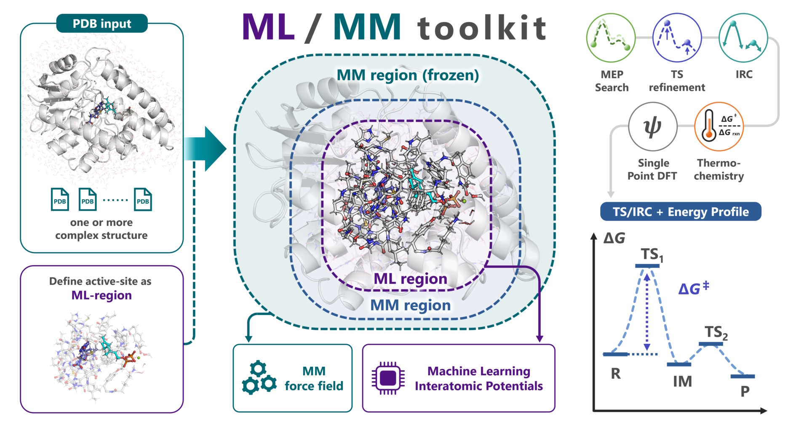

# Getting Started

::::{container} p2r-intro


:::{container} p2r-intro-text
`mlmm-toolkit` is a Python command-line toolkit that uses ML/MM (machine learning / molecular mechanics) to **search automatically for candidate enzyme reaction pathways, starting from PDB / mmCIF structures**.

The reacting part of the enzyme (the ML region) is computed with a machine-learning interatomic potential (MLIP), and the protein around it with an Amber force field (MM). MLIPs are neural networks trained on DFT (density functional theory) data; they give energies and forces close to DFT accuracy at a much lower cost.

In many cases, a **single command** like this one gives a first draft of the reaction pathway:

```bash
mlmm -i 1.R.pdb 3.P.pdb -c 'SAM,GPP,MG' -l 'SAM:1,GPP:-3'
```
:::
::::

This page follows the steps of studying an enzyme reaction mechanism and explains the basics of computational chemistry and how to use `mlmm-toolkit` along the way.

> **Examples:** the [`examples/beza/`](https://github.com/t-0hmura/mlmm_toolkit/tree/main/examples/beza) directory holds the structures used above (`1.R.pdb`, `3.P.pdb`) and a workflow script (MEP search and scan pipelines) built around the GPP C6-methyltransferase BezA ([Tsutsumi et al., *Angew. Chem. Int. Ed.* 2022, 61, e202111217](https://doi.org/10.1002/anie.202111217)). After [installation](installation.md), get it with `git clone https://github.com/t-0hmura/mlmm_toolkit && cd mlmm_toolkit/examples/beza` and run the command above there.

---

## Overall workflow

An enzyme reaction mechanism is studied in the seven steps below. `mlmm-toolkit` runs steps 2–6 in a row with one command.

| Step | What you use | In `mlmm-toolkit` |
| --- | --- | --- |
| 1. Prepare the complex structure | Structure prediction or docking → MD | Outside `mlmm-toolkit` |
| 2. Build the ML region and layers | `extract`, `mm-parm`, `define-layer` | `extract` and `define-layer` with `-c`; `mm-parm` without `--parm7` |
| 3. Find the reaction pathway | `scan`, `path-opt`, `path-search` | `scan` with `-s`; the path search in every mode except TS-only mode |
| 4. Optimize the TS and check the imaginary mode | `tsopt` | With `--tsopt` |
| 5. Check that the TS connects R and P | `irc` | With `--tsopt` |
| 6. Compare the energies | `freq`, `dft` | With `--tsopt` plus `--thermo` / `--dft` |
| 7. Make an overall judgment | Fraction of reactive arrangements (NAC), minimum and median barriers | Over several snapshots |

This command runs all of steps 2–6:

```bash
mlmm -i 1.R.pdb 3.P.pdb -c 'SAM,GPP,MG' -l 'SAM:1,GPP:-3' --tsopt --thermo --dft
```

Each step also runs on its own as a subcommand ([`extract`](extract.md), [`mm-parm`](mm-parm.md), [`define-layer`](define-layer.md), [`tsopt`](tsopt.md), [`irc`](irc.md), and so on; see the [subcommand list](index.md#subcommands)).

---

## 1. Prepare the complex structure

Build a structure of the enzyme–substrate complex with structure prediction such as AlphaFold 3, Boltz-2, or OpenFold3, or with a docking tool. Run molecular dynamics (MD) on it and take snapshots of various conformations. The Amber topology used in the MD can be reused with `--parm7`. Rather than drawing a conclusion from one structure, compute several snapshots.

For the structures you give `mlmm-toolkit`, watch these three points.

### Add hydrogens (required)

Input structures must contain **every hydrogen atom**; `all` does not add them. When a structure lacks hydrogens (a crystal structure, for example), add them beforehand with a tool such as these:

| Recommended tool | Example command | Notes |
| --- | --- | --- |
| **reduce** (Richardson Lab) | `reduce input.pdb > output.pdb` | Fast; widely used to add hydrogens to crystal structures |
| **pdb2pqr** | `pdb2pqr --ff=AMBER input.pdb output.pqr` | Adds hydrogens and assigns partial charges |
| **Open Babel** | `obabel input.pdb -O output.pdb -h` | General-purpose cheminformatics toolkit |
| **mm-parm --add-h** | `mlmm mm-parm -i input.pdb --add-h` | Adds hydrogens with PDBFixer at `--ph` (default 7.0) |

`all` fills blank element columns (77–78) by itself; before a standalone command such as `extract`, fill them with [`add-elem-info`](add-elem-info.md). If the PDB has alternate locations (altLoc), keep one per residue with [`fix-altloc`](fix-altloc.md).

### Keep the same atom order (multiple structures)

When the input has several structures, such as a reactant (R) and a product (P), **every structure must list the same atoms in the same order** (only the coordinates differ). Run the hydrogen tool on every structure with the same settings, and in PyMOL tick *Original atom order* when saving. An atom that moves to another residue keeps its residue and atom name from R: in the bundled example, the hydrogen that GPP passes to Glu186 is still `H11` of `GPP 321` in `3.P.pdb`.

### Match `-l` to the hydrogens

Give each ligand the charge that matches the hydrogens in the file. In the bundled example, SAM has 23 hydrogens, so it is `SAM:1`; with 22 hydrogens it would be `SAM:0`. When the charge and the hydrogens do not match, `mm-parm` stops with an electron-count error before it runs `antechamber`.

mmCIF (`.cif`, `.mmcif`) and PDB files beyond the fixed-column limits of the PDB format work with `all` and the calculation commands; the standalone `mm-parm` reads PDB only. See {ref}`mmCIF input <mmcif-input>` for details.

---

## 2. Build the ML region and layers

An enzyme has thousands to tens of thousands of atoms, too many to compute entirely with DFT. Instead, only the reacting part is computed with an accurate method, and the protein around it with a light molecular mechanics (MM) force field. Computing the reacting part with quantum chemistry (QM) is the QM/MM method; replacing that QM with an MLIP gives **ML/MM**. `mlmm-toolkit` combines the two calculations by the **ONIOM** subtraction:

```text
E_total = E_REAL_low + E_MODEL_high - E_MODEL_low
```

REAL is the full system and MODEL the ML region; high is the MLIP, and low is the MM backend. The full system is computed with MM, the ML region with both the MLIP and MM, and the MM energy of the ML region is subtracted so that it is not counted twice.

- **ML region**: `all` takes as the ML region the residues with an atom within `-r` (default 2.6 Å) of the substrates given with `-c`.
- **Link atoms**: where the boundary between the ML region and MM cuts a covalent bond, the ML-region calculation caps the ML side of the cut bond with a hydrogen (a link hydrogen). The link hydrogen sits along the cut bond, and the force on it is passed back to the atoms on both sides. `mlmm-toolkit` places the link hydrogens automatically ([ML/MM Calculator](mlmm-calc.md#link-atom-redistribution)).
- **MM layers**: `mm-parm` builds the Amber topology of the full system, and `define-layer` splits the atoms outside the ML region into Movable-MM, which moves during optimizations, and Frozen-MM farther out, which stays fixed. The layers are stored in the B-factor column of the PDB.

See [Building the ML region and layers](model-setup.md) for details.

**Compared with a cluster model**: a cluster model cuts out only the part involved in the reaction, so to keep the shape and environment of the protein it needs a large model that also holds residues not directly involved in the reaction. ML/MM keeps the surrounding protein as MM, so the ML region is easier to shrink to just the reacting part, and the calculation can be lighter than with a cluster model. In the bundled example, the default ML region has 632 atoms; moving the main-chain atoms to MM gives 397 atoms, and picking the residues yourself gives 129 atoms ([Shrink the ML region](model-setup.md#shrink-the-ml-region)).

**Size of the ML region**: in a study of COMT (catechol *O*-methyltransferase) that varied the size of the QM region in QM/MM, adding residues in order of distance from the substrate made the activation energy nearly constant at about 500–600 atoms ([Kulik et al., *J. Phys. Chem. B* 2016, 120, 11381](https://doi.org/10.1021/acs.jpcb.6b07814)). When you pin down barrier values, check that enlarging the ML region does not change the result. When a residue involved in the reaction is missing, raise `-r` or add the residue to `-c` or `--selected-resn` ({ref}`Make the model larger <model-setup-larger>`).

---

## 3. Find the reaction pathway

Optimize the reactant (R) and product (P) structures, and search for the minimum energy path (MEP) that connects R and P. The highest-energy point on the path is the candidate for the transition state (TS). This step is the same as in a reaction-mechanism study of small molecules.

There are three ways to give the input:

| Mode | Input | What happens |
| --- | --- | --- |
| **Endpoint mode** | Two or more PDBs (`-i R.pdb P.pdb`) | Builds the ML region and layers from the structures and searches the MEP |
| **Scan-list mode** | One PDB + `--scan-lists` (`-s`) | Drives the chosen distances, angles, or dihedrals step by step to build the pathway |
| **TS-only mode** | One PDB + `--tsopt` | Skips the MEP search and goes straight to optimizing the TS candidate and running IRC |

> **Note:** a single-structure input needs either `--scan-lists/-s` or `--tsopt`.

---

## 4. Optimize the TS and check the imaginary mode

A TS is a point where the energy is a maximum along the direction in which the reaction proceeds and a minimum along every other direction (a first-order saddle point). A frequency calculation at this point gives an imaginary frequency (an imaginary mode) for the reaction direction only. If n_imag (the number of imaginary modes) is 0, the point is a minimum; if it is 2 or more, the point is not a TS.

A successful TS optimization gives one imaginary mode along the reaction coordinate. Also check that this mode moves the intended bonds that form and break.

**Frozen atoms and PHVA**: when atoms are frozen, as in Frozen-MM, the energy is neither a minimum nor a saddle point along the directions that move the frozen atoms. A frequency calculation over all atoms can therefore show imaginary modes that come only from the freezing. Instead, the frequencies are taken from the Hessian (the second derivative of the energy) of the movable atoms only. This is called partial Hessian vibrational analysis (PHVA), and `freq` in `mlmm-toolkit` runs it over the ML region and the Movable-MM atoms.

---

## 5. Check that the TS connects R and P

One imaginary mode does not guarantee that the TS lies between the intended R and P. The IRC (intrinsic reaction coordinate) goes downhill from the TS to both sides; check that it ends at the intended R and P. `mlmm-toolkit` also optimizes both IRC endpoints, so even if the IRC stops partway, the result is usable when the endpoint optimizations reach the intended R and P.

---

## 6. Compare the energies

`--thermo` adds the thermochemical correction (Gibbs free energy) from vibrational analysis, and `--dft` adds DFT single points; with them you get the activation energy (R → TS) and the reaction energy (R → P).

When the run finishes, the output directory (`-o`, default `./result_all/`) contains the following files. [Output Directory Layout](output-layout.md) lists the main files, and {ref}`JSON Output Reference <summary-json-path-search-all>` every key of `summary.json`.

| File / folder | Contents |
| --- | --- |
| `summary.log` | Text summary (directory layout and progress of each stage) |
| `summary.json` | Machine-readable results (barriers, energies of each state, bond changes) |
| `energy_diagram_*.png` | Energy profile plots (electronic energy / Gibbs-corrected) |
| `mep_trj.pdb` / `mep_trj.cif` | Animated trajectory of the minimum energy path (MEP) |
| `ml_region.pdb`, `mm_parm/`, `layered/` | The ML region, the full-system Amber topology, and the layered full-system PDBs; reuse them with `--model-pdb` and `--parm7` |
| `segments/seg_NN/` | Detailed results for each reaction segment (optimized R/TS/P structures, IRC trajectories, and more; with `--tsopt`) |

At the end of the terminal output, the `Scientific status:` line under `====== Pipeline summary ======` (`scientific_status` in `summary.json`) is `success` when every requested stage converged, otherwise `partial` or `failed` with the reasons in `scientific_status_reasons`. Whether the TS has n_imag = 1 and the endpoints are the intended R and P is for you to check; each quickstart lists the files to open.

---

## 7. Make an overall judgment

One pathway is not enough for a conclusion. Judge whether the mechanism is plausible by looking together at how often reactive arrangements appear in the MD (near-attack conformations, NACs: the reacting atoms are close and oriented to react) and at the minimum and median barriers over several snapshots.

The results depend strongly on the starting structure and on how the model is built, so trial and error, recomputing with other structures and models, cannot be avoided. `mlmm-toolkit` automates steps 2–6 and computes them fast with MLIPs, so it suits this trial and error.

---

## Going further

`mlmm-toolkit` is especially useful for high-throughput calculations over many substrates or mutants, for supporting experimental results, and for trial and error.

MD of the whole system with an MLIP, or ML/MM MD, also shows the dynamics of the whole enzyme. These MD runs cost more than cluster-model or ML/MM calculations on the potential energy surface, so a good approach is to run them after `mlmm-toolkit` has confirmed the mechanism.

MLIPs are a fairly new technology, so for a purely computational paper, DFT calculations will probably still be expected for a while. `mlmm-toolkit` also has a DFT backend, so everything up to QM/MM (DFT/MM) calculations, with the ML region computed by DFT, stays within one tool ([Refine an MLIP TS with DFT](dft-backend.md)). Give it a try.

---

## Where to start

For environment setup, see the [Installation guide](installation.md).

* **Try it in a web browser**: the [Colab GUI notebook](https://colab.research.google.com/github/t-0hmura/mlmm_toolkit/blob/main/examples/mlmm_colab.ipynb) (pick the ML region in 3D)
* **Start from several PDB structures**: [Quickstart: `mlmm all`](quickstart-all.md)
* **Explore from one PDB structure with a scan**: [Quickstart: `mlmm all --scan-lists`](quickstart-scan.md)
* **Optimize and check a TS candidate**: [Quickstart: TS-only mode](quickstart-tsopt.md)

---

## How the command works

Installation provides the `mlmm` command. Without a subcommand, `all` runs.

```bash
# These two do the same thing
mlmm [OPTIONS]...
mlmm all [OPTIONS]...
```

### Choosing between all and individual commands

* **Use `all`** to run model setup → MEP search → TS optimization and IRC → frequencies and DFT in one command, or while you are still exploring and want one command to manage the outputs.
* **Use the individual commands** to run each stage in turn and check its result before the next; for a complex reaction, this often works better than one `all` run. They also fit a custom sequence and a run that reuses the parm7 and layered PDB of an earlier run.

The individual ML/MM commands need the full-system topology (`--parm7`) and the ML region (`--model-pdb`, `--model-indices`, or the B-factor layers of the input); `all` builds both. `-q` is the charge of the ML region, not of the whole system. See {ref}`ML/MM options <mlmm-options>`.

---

## Main CLI options

| Option | Example | Description |
| --- | --- | --- |
| `-i, --input` | `1.R.pdb 3.P.pdb` | Input structure files (PDB / mmCIF); accepts several |
| `-c, --center` | `'SAM,GPP'` / `'A:SAM:123'` | Extraction center (substrate residue names, residue IDs, or a PDB file); the ML region is cut out around it. Without it, no extraction runs, the whole structure is used, and the ML region comes from the B-factor layers or `--model-pdb` (with neither, the run stops with an error) |
| `-l, --ligand-charge` | `'SAM:1,GPP:-3'` | Formal charge of each ligand, as a mapping (standard residues and ions are counted automatically) |
| `-q, --charge` | `-2` | Total charge of the ML region, not of the whole system (set it to override the automatic value) |
| `-m, --multiplicity` | `1` | Spin multiplicity (default `1`, a singlet) |
| `--parm7` | `real.parm7` | Full-system Amber topology to reuse, such as one from an earlier run or from the MD that produced the input snapshot; skips `mm-parm` |
| `--model-pdb` | `ml_region.pdb` | ML region as a PDB; takes precedence over `-c` and the B-factor layers |
| `--tsopt/--no-tsopt` | (flag) | Turns on TS optimization and IRC |
| `--thermo/--no-thermo` | (flag) | Runs vibrational analysis and thermochemical correction with the QRRHO (quasi-rigid-rotor harmonic oscillator) model (with `--tsopt`) |
| `--dft/--no-dft` | (flag) | Runs DFT single points on the resulting structures (with `--tsopt`) |
| `-b, --backend` | `uma` / `orb` / `mace` | Backend for the ML region (default `uma`; `dft` is also available) |

For the syntax rules, see [Common options and selectors](cli-conventions.md); for every option, see the [`all` CLI reference](reference/commands/all.md).

---

## AI agent skills

`mlmm-toolkit` ships instructions for AI agents (Claude Code, Codex, Cursor, and others) in the `skills/` directory. To install them, tell your AI agent:

> Import `https://github.com/t-0hmura/mlmm_toolkit/tree/main/skills` as skills, and install mlmm-toolkit by following `mlmm-install`.

If you cloned the GitHub repository, you can give the local `skills/` path instead. Then you can ask, for example:

> Read *the paper*, build a model from the PDB structure *PDB ID*, and study the mechanism of *the reaction step* with the mlmm-toolkit skills.

The skills cover the CLI subcommands, structure input and output, backend installation, TS search strategy, and HPC runs. Load `skills/` into an agent, and it can run and analyze calculations from plain-language instructions. For where to place the files and the full list of skills, see [`skills/README.md`](https://github.com/t-0hmura/mlmm_toolkit/blob/main/skills/README.md).

---

## Troubleshooting and support

If an error occurs during a run, see these pages:

* {ref}`Troubleshooting <troubleshooting-quick-table>`: fixes by error symptom, and solutions for installation and environment problems
* [MLIP Backends](backends.md): choosing a backend and running parallel workers; [Device Configuration & HPC Setup](device-hpc.md) for GPU memory, device settings, and job scripts on clusters

To see every option of a command, use the help options:

```bash
mlmm <subcommand> --help
mlmm all --help-advanced
```

Report unresolved problems and bugs on [GitHub Issues](https://github.com/t-0hmura/mlmm_toolkit/issues).
